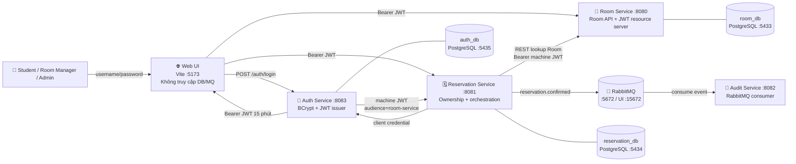
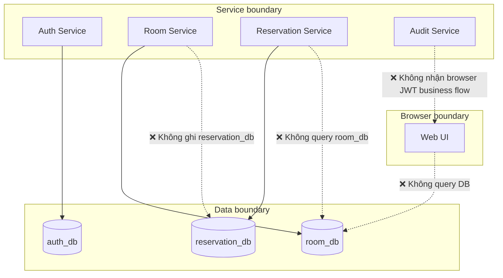
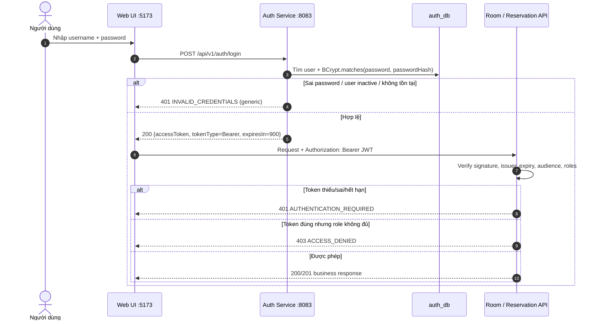
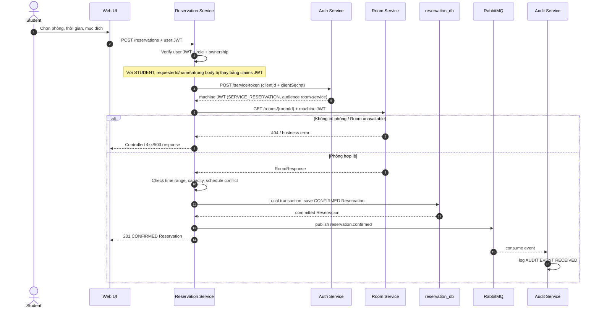
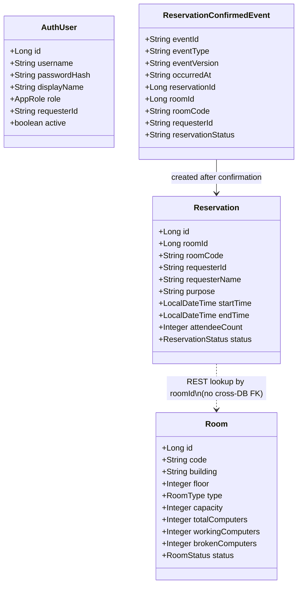
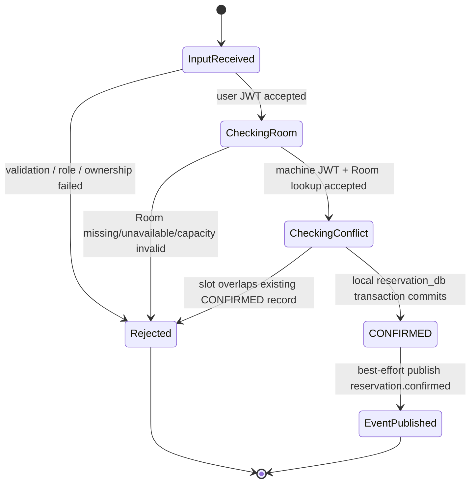

# SOA Room Reservation — TH1 đến TH5

> **Một hệ thống quản lý phòng học và đăng ký sử dụng phòng theo hướng dịch vụ (service-oriented), không phải một tập hợp CRUD rời rạc.**
>
> Mục tiêu của dự án là mô tả rõ: ai sở hữu dữ liệu nào, request đi qua đâu, service nào được quyền gọi service nào, lỗi được trả về thế nào và vì sao người dùng không thể xem/sửa dữ liệu không thuộc quyền của mình.

| Phiên bản source hiện tại | Git branch | Commit nền TH5 |
|---|---|---|
| TH1 → TH5 | `feature/th5-auth-security` | `3966014` — `feat(th5): add JWT authentication and authorization` |

> `main`/tag `th4-postgresql-jpa-persistence-complete` (`28b0ff4`) là snapshot TH4. Muốn chạy Auth/JWT/RBAC/Web UI TH5 phải dùng branch `feature/th5-auth-security`.

---

## 1. Đọc trong 90 giây: dự án này giải quyết việc gì?

Một trường có các phòng lý thuyết/lab. Sinh viên cần đăng ký phòng cho một khoảng thời gian; cán bộ quản lý cần quản trị phòng; quản trị viên có quyền nghiệp vụ rộng hơn. Hệ thống phải trả lời được các câu hỏi rất cụ thể:

1. **Phòng nào có tồn tại, còn hoạt động và đủ chỗ không?** → Room Service.
2. **Khoảng giờ này có bị người khác đăng ký trùng không?** → Reservation Service.
3. **Ai đang gọi API, họ có role gì và họ có được làm việc này không?** → Auth Service + Spring Security.
4. **Sinh viên A có thể gửi mã sinh viên B trong body để tạo/xem hộ không?** → Không. Reservation Service lấy identity từ JWT, không tin body/query của browser.
5. **Một Reservation vừa được xác nhận có được theo dõi độc lập không?** → Reservation publish event; Audit Service consume từ RabbitMQ.

Nói ngắn gọn: **Room quản lý phòng; Reservation quản lý lịch đăng ký; Auth quản lý danh tính/token; Audit quan sát event.** Không service nào được “tiện tay” dùng database của service khác.

---

## 2. Bản đồ năng lực theo từng học phần

| Mốc | Năng lực đã triển khai | Câu hỏi phải trả lời được khi bảo vệ |
|---|---|---|
| **TH1** | Room CRUD, validation, error response, search | Vì sao Room là owner duy nhất của dữ liệu phòng? |
| **TH2** | Reservation, gọi REST Room đồng bộ, retry/fallback, RabbitMQ Audit | Reservation tạo được vì sao vẫn phải gọi Room? Khi Room/RabbitMQ chết thì sao? |
| **TH3** | API v2 filter/sort/pagination, Swagger/OpenAPI, CORS, Web UI | UI lấy dữ liệu qua API thế nào, không đọc database ra sao? |
| **TH4** | PostgreSQL/JPA, DB riêng theo service, local transaction, persistence after restart | Vì sao `room_id` không có foreign key vật lý sang `room_db`? |
| **TH5** | Auth Service, BCrypt, JWT 15 phút, RBAC, ownership, service token | Khác nhau giữa 401/403? Vì sao Student không giả requesterId? Vì sao service không forward token người dùng? |
| **TH6** | Consumer Reservation tích hợp Room Provider thành flow xác nhận Reservation xuyên service; contract, sequence diagram, error/timeout tests | Consumer gọi Provider nào? Dữ liệu nào được trust? Khi Provider 404/409/503 thì Reservation có được ghi không? |

---

## 3. Từ ngữ tối thiểu cho người không học chuyên ngành

| Khái niệm | Cách hiểu đơn giản | Trong dự án này |
|---|---|---|
| **Service** | Một bộ phận độc lập có nhiệm vụ rõ, giao tiếp qua “cửa tiếp nhận” API | Room, Reservation, Auth, Audit |
| **API** | Hợp đồng input/output giữa hai thành phần | `POST /api/v1/reservations`, `GET /api/v2/rooms` |
| **Database owner** | Chỉ một service được đọc/ghi trực tiếp DB của mình | Room → `room_db`; Reservation → `reservation_db`; Auth → `auth_db` |
| **Synchronous** | Bên gọi phải chờ câu trả lời ngay | Reservation gọi Room để kiểm tra phòng trước khi confirm |
| **Asynchronous event** | Bên gửi phát thông báo và không phải chờ bên nhận xử lý | Reservation publish `reservation.confirmed`; Audit consume |
| **JWT** | Thẻ định danh có chữ ký số, hết hạn; API kiểm tra chữ ký trước khi tin | Bearer token sống 900 giây |
| **RBAC** | Role-Based Access Control: quyền dựa trên role | STUDENT / ROOM_MANAGER / ADMIN |
| **Ownership** | Quyền dựa trên việc resource có thuộc người gọi hay không | Student chỉ thấy/tạo Reservation của chính mình |

---

# 4. Kiến trúc tổng thể (System Context / UML Component View)



## 4.1 Quy tắc kiến trúc không được phá vỡ



| Quy tắc | Lý do |
|---|---|
| Reservation chỉ biết `roomId`/`roomCode` như external reference | Room Service vẫn là owner của tồn tại, trạng thái, sức chứa phòng. |
| Không foreign key vật lý `reservation_db → room_db` | Hai DB khác nhau, hai lifecycle khác nhau; cross-service consistency phải qua API/event. |
| Web UI chỉ gọi REST API | Browser không có credential DB/RabbitMQ và không được chứa secret nội bộ. |
| Audit không quyết định Reservation có thành công hay không | Audit là side effect bất đồng bộ; business transaction phải tự nhất quán trong `reservation_db`. |

---

# 5. Trục tích hợp: request đi đâu, input là gì, output là gì?

## 5.1 Ma trận tích hợp

| Từ | Đến | Kiểu | Input | Output/ý nghĩa | Nếu thất bại |
|---|---|---|---|---|---|
| Web UI | Auth | HTTP REST | `username`, `password` | JWT user 900 giây | `401 INVALID_CREDENTIALS` |
| Web UI | Room | HTTP REST + user JWT | Bearer token, room query/body | Room data hoặc mutation result | `401`/`403`/validation error |
| Web UI | Reservation | HTTP REST + user JWT | Bearer token, Reservation body/query | Reservation data | role + ownership enforced |
| Reservation | Auth | HTTP REST + client credential | `clientId`, `clientSecret` | machine JWT có audience `room-service` | controlled server error nếu Auth unavailable/config sai |
| Reservation | Room | HTTP REST + machine JWT | `roomId` | room `id`, `code`, `capacity`, `status` | 404/503 after retry policy |
| Reservation | RabbitMQ | AMQP event | `ReservationConfirmedEvent` | event accepted by broker | Reservation đã commit; event gap là known future-work risk |
| RabbitMQ | Audit | AMQP consume | `reservation.confirmed` event | `AUDIT EVENT RECEIVED` log | audit processing tách khỏi create request |

## 5.2 Luồng login và truy cập API (UML Sequence)



## 5.3 Luồng tạo Reservation — synchronous + asynchronous (UML Sequence)



> **Điểm thầy có thể hỏi:** Transaction chỉ bảo đảm kiểm tra conflict và ghi vào `reservation_db`. Publish RabbitMQ xảy ra **sau local commit**. Nếu broker chết đúng thời điểm đó, Reservation có thể `CONFIRMED` nhưng Audit event bị thiếu. Transactional outbox là hướng nâng cấp, không giả vờ đã có distributed transaction.

---

# 6. Service contracts và input/output thực tế

## 6.1 Auth Service — `http://localhost:8083`

### Login

```http
POST /api/v1/auth/login
Content-Type: application/json

{
  "username": "student01",
  "password": "DemoPassword123!"
}
```

```json
{
  "accessToken": "<JWT redacted>",
  "tokenType": "Bearer",
  "expiresIn": 900
}
```

### JWT business claims (minh họa)

```json
{
  "iss": "soa-room-reservation-auth",
  "sub": "student01",
  "displayName": "Student One",
  "requesterId": "STUDENT-001",
  "roles": ["STUDENT"],
  "audiences": ["room-service", "reservation-service"],
  "iat": "...",
  "exp": "..."
}
```

> UI chỉ decode payload để hiển thị trạng thái. **UI không phải nơi quyết định quyền.** Room/Reservation tự verify chữ ký và claims ở server.

### Service token (chỉ Reservation Service dùng)

```http
POST /api/v1/auth/service-token
Content-Type: application/json

{
  "clientId": "reservation-service",
  "clientSecret": "<RESERVATION_SERVICE_CLIENT_SECRET>"
}
```

Response là JWT subject `reservation-service`, role `SERVICE_RESERVATION`, audience chỉ `room-service`. Browser không được giữ/hiển thị secret này.

## 6.2 Room Service — `http://localhost:8080`

| Endpoint | Input chính | Role tối thiểu | Output chính |
|---|---|---|---|
| `GET /api/v1/rooms`, `GET /api/v2/rooms` | Bearer JWT; v2 nhận filter/page/sort | Authenticated | list/page Room |
| `GET /api/v1/rooms/{id}` | `id`, Bearer JWT | Authenticated hoặc machine identity đúng audience | Room |
| `POST /api/v1/rooms` | `code`, building, floor, type, capacity, computer counts, status | `ROOM_MANAGER` hoặc `ADMIN` | `201` Room |
| `PUT /api/v1/rooms/{id}` | id + Room body | `ROOM_MANAGER` hoặc `ADMIN` | updated Room |
| `DELETE /api/v1/rooms/{id}` | id | `ROOM_MANAGER` hoặc `ADMIN` | `204` |

```json
{
  "code": "A301",
  "building": "A",
  "floor": 3,
  "type": "LAB",
  "capacity": 45,
  "totalComputers": 45,
  "workingComputers": 42,
  "brokenComputers": 3,
  "status": "AVAILABLE"
}
```

## 6.3 Reservation Service — `http://localhost:8081`

| Endpoint | Input chính | Policy | Output |
|---|---|---|---|
| `POST /api/v1/reservations` | roomId, requester fields, purpose, start/end, attendeeCount | `STUDENT` cho chính mình; `ADMIN` có thể tạo hộ | `201 CONFIRMED` nếu room/schedule hợp lệ |
| `GET /api/v1/reservations` | Bearer JWT | Student chỉ list own; manager/admin list schedule | Reservation list |
| `GET /api/v2/reservations` | optional roomId/requesterId/status/from/to/page/size/sort | Student query bị ép requesterId claim | Reservation page |

```json
{
  "roomId": 1,
  "requesterId": "STUDENT-002",
  "requesterName": "Nguoi gia mao",
  "purpose": "Study group",
  "startTime": "2026-10-27T09:00:00",
  "endTime": "2026-10-27T10:00:00",
  "attendeeCount": 20
}
```

Nếu token là `student01`, Reservation Service chuẩn hóa input trên thành:

```json
{
  "requesterId": "STUDENT-001",
  "requesterName": "Student One"
}
```

Hai trường identity do JWT quyết định. Đây là **ownership enforcement server-side**, không phải mẹo khóa ô input ở UI.

## 6.4 Audit Service — `http://localhost:8082`

Audit hiện có health endpoint `/api/v1/audits/hello` và consumer RabbitMQ. Nó log event nhận được; **chưa phải** một hệ thống audit persistence/search hoàn chỉnh. Nói rõ giới hạn này đáng tin hơn việc quảng cáo quá phạm vi source.

---

# 7. Mô hình dữ liệu (UML Class / Data View)



| Database | Bảng/chức năng trọng tâm | Được truy cập trực tiếp bởi |
|---|---|---|
| `auth_db` | `auth_users`: username, BCrypt password hash, role, requesterId, active | Auth Service |
| `room_db` | `rooms`: code, location, type, capacity, computer counts, status | Room Service |
| `reservation_db` | `reservations`: external `room_id`, snapshot `room_code`, requester, slot, status | Reservation Service |

---

# 8. Authentication, authorization và ownership

## 8.1 Local demo accounts

> Chỉ dùng local/demo; password plain text không được lưu DB. Auth Service seed BCrypt hash khi account chưa tồn tại.

| Username | Password local | Role | requesterId |
|---|---|---|---|
| `student01` | `DemoPassword123!` | `STUDENT` | `STUDENT-001` |
| `student02` | `DemoPassword123!` | `STUDENT` | `STUDENT-002` |
| `roommanager01` | `DemoPassword123!` | `ROOM_MANAGER` | — |
| `admin01` | `DemoPassword123!` | `ADMIN` | — |

## 8.2 Role/permission matrix

| Hành động | STUDENT | ROOM_MANAGER | ADMIN | SERVICE_RESERVATION |
|---|:---:|:---:|:---:|:---:|
| Login | Public | Public | Public | Không dùng user login |
| GET Room v1/v2 | ✅ JWT | ✅ JWT | ✅ JWT | ✅ chỉ lookup nội bộ |
| POST/PUT/DELETE Room | ❌ | ✅ | ✅ | ❌ |
| POST Reservation | ✅ nhưng chỉ chính mình | ❌ | ✅ tạo hộ | ❌ |
| GET Reservation v1/v2 | ✅ chỉ own | ✅ lịch tổng | ✅ lịch tổng | ❌ |
| Reservation → Room internal call | ❌ | ❌ | ❌ | ✅ machine JWT riêng |

## 8.3 HTTP semantics phải nói đúng

| Status | Ý nghĩa trong dự án | Ví dụ |
|---|---|---|
| `401 AUTHENTICATION_REQUIRED` | Identity chưa được xác thực: thiếu/malformed/expired/signature/issuer/audience sai | `GET /api/v1/rooms` không gửi Bearer token |
| `403 ACCESS_DENIED` | Token hợp lệ nhưng principal không có role/quyền phù hợp | Student `POST /api/v1/rooms` |
| `400 VALIDATION_ERROR` | Body/query sai định dạng hoặc business input cơ bản sai | endTime không sau startTime |
| `404 ROOM_NOT_FOUND` | Room không tồn tại | Reservation roomId không hợp lệ |
| `409` | Conflict nghiệp vụ | Slot Reservation overlap cùng room |
| `503 ROOM_SERVICE_UNAVAILABLE` | Downstream Room unavailable sau retry/fallback | Room Service không reach được |

---

# 9. Quyết định thiết kế quan trọng và anti-pattern đã tránh

| Không làm | Vì sao sai/rủi ro | Cách source hiện tại làm |
|---|---|---|
| Web UI tự quyết “Student không được tạo Room” | Người dùng có thể gọi API trực tiếp, sửa JS hoặc Postman | Spring Security ở Room Service trả 403 server-side |
| Tin `requesterId` trong JSON body | Student A có thể gửi ID của Student B | ReservationAccessPolicy lấy requesterId/displayName từ JWT |
| Reservation query trực tiếp `room_db` | Coupling DB, phá ownership, khó deploy/scale riêng | REST Room lookup qua contract |
| Reservation forward user JWT sang Room | Downstream nhận end-user privilege/audience không cần thiết | Reservation xin machine token `SERVICE_RESERVATION` audience `room-service` |
| Chỉ nhìn HTTP 200 rồi kết luận security đúng | Có thể 200 nhưng lộ data người khác | Test 401, 403, spoof body, spoof query, Student 02 isolation |
| Dùng `docker compose down -v` để “sửa mọi lỗi” | Xóa toàn bộ local data/evidence persistence | `docker compose ps`, logs, `stop`/`up -d` trước |
| Commit `.env`/JWT/token | Lộ secret, không còn secret management | `.env` ignored; chỉ commit `.env.example` placeholder |

---

# 10. Cấu trúc source: nhìn code theo trách nhiệm, không nhìn theo số file

```text
soa-room-reservation/
├── auth-service/                         # Identity owner
│   ├── auth/                              # User entity, BCrypt login, demo seeds
│   ├── security/JwtTokenService.java      # Issue user/service JWT
│   └── config/SecurityConfig.java
├── room-service/                          # Room owner
│   ├── room/                              # REST contract + Room business rules
│   ├── persistence/                       # JPA RoomEntity/Repository/Mapper
│   └── security/                          # JWT verify/filter/RBAC/error writer
├── reservation-service/                   # Reservation owner/orchestrator
│   ├── reservation/                       # Conflict/capacity/time business rules + JPA
│   ├── client/                            # RoomClient + ServiceTokenClient
│   ├── security/                          # JWT verify + ownership policy
│   └── messaging/                         # RabbitMQ event publisher/topology
├── audit-service/                         # RabbitMQ consumer / audit log
├── web-ui/                                # Vite UI, login/session/Bearer requests
├── security-design/                       # Requirement, role matrix, completed runtime evidence
├── postman/TH5_Security.postman_collection.json
├── postman/TH5_Security_Extended_Evidence.postman_collection.json
├── docs/                                  # Design + operation guides
├── docker-compose.yml                     # RabbitMQ + 3 isolated PostgreSQL DBs
└── scripts/Import-LocalEnv.ps1            # Load .env into one PowerShell process
```

---

# 11. Chạy local: quick start có kiểm soát

> Hướng dẫn thao tác đầy đủ cho người mới: [`docs/th5-operation-guide.md`](docs/th5-operation-guide.md) và file Word `HUONG_DAN_CHAY_DU_AN_TH1_DEN_TH5_FINAL.docx`.

## 11.1 Chọn đúng branch

```powershell
Set-Location D:\soa-room-reservation
git fetch origin --prune
git switch feature/th5-auth-security
git pull --ff-only
git log -1 --oneline
```

Kỳ vọng commit `3966014`.

## 11.2 Tạo `.env` và secret (một lần/máy)

```powershell
Copy-Item .env.example .env
notepad .env
```

Thay `REPLACE_...` bằng Base64 JWT secret tối thiểu 32 byte và một service secret dài/ngẫu nhiên. **Không commit `.env`.**

## 11.3 Docker

```powershell
Set-Location D:\soa-room-reservation
docker compose up -d
docker compose ps
```

Chờ `soa-rabbitmq`, `soa-room-db`, `soa-reservation-db`, `soa-auth-db` đều `healthy`.

## 11.4 Java services — mỗi service một PowerShell

```powershell
# Chạy phần này đầu mỗi terminal Java
Set-Location D:\soa-room-reservation
Set-ExecutionPolicy -Scope Process -ExecutionPolicy Bypass -Force
. .\scripts\Import-LocalEnv.ps1
```

Thứ tự runtime: **Auth → Room → Reservation → Audit → Web UI**.

```powershell
# Auth Service :8083
Set-Location D:\soa-room-reservation\auth-service
.\mvnw.cmd clean test
.\mvnw.cmd spring-boot:run
```

```powershell
# Room Service :8080
Set-Location D:\soa-room-reservation\room-service
.\mvnw.cmd clean test
.\mvnw.cmd spring-boot:run
```

```powershell
# Reservation Service :8081
Set-Location D:\soa-room-reservation\reservation-service
.\mvnw.cmd clean test
.\mvnw.cmd spring-boot:run
```

```powershell
# Audit Service :8082
Set-Location D:\soa-room-reservation\audit-service
.\mvnw.cmd clean test
.\mvnw.cmd spring-boot:run
```

```powershell
# Web UI :5173 — dùng strict port vì CORS local allow origin này
Set-Location D:\soa-room-reservation\web-ui
npm ci
npm run dev -- --port 5173 --strictPort
```

| Component | URL |
|---|---|
| Web UI | http://localhost:5173 |
| Auth Swagger | http://localhost:8083/swagger-ui.html |
| Room Swagger | http://localhost:8080/swagger-ui.html |
| Reservation Swagger | http://localhost:8081/swagger-ui.html |
| RabbitMQ UI | http://localhost:15672 (`soa` / `soa-local-dev`) |

---

# 12. Security evidence và runtime validation

## 12.1 Runtime đã xác nhận trên Windows

| Evidence | Kết quả |
|---|---|
| Auth `clean test` + PostgreSQL runtime + demo account seed | Pass |
| Room `clean test` + runtime :8080 | Pass |
| Room no token | `401 AUTHENTICATION_REQUIRED` JSON |
| Student JWT GET Room | `200` với danh sách Room |
| Student JWT POST Room | `403 ACCESS_DENIED` JSON |
| Reservation `clean test` + runtime :8081 | Pass |
| Web UI login/protected data load sau CORS Authorization fix | Pass |
| Git commit/push TH5 branch | Pass (`3966014`) |

## 12.2 Runtime evidence đã hoàn thành và regression còn dùng

Runtime TH5 đã được chạy thành công trên môi trường local: login đúng/sai, no-token 401, Student Room read 200, Student Room mutation 403, Manager Room create 201, spoof/foreign ownership, Student02 isolation, machine token Room lookup và Audit receipt. Chi tiết kết quả nằm trong [`security-design/test-results.md`](security-design/test-results.md).

Hai collection được giữ với mục đích khác nhau:

1. [`postman/TH5_Security.postman_collection.json`](postman/TH5_Security.postman_collection.json): collection gốc 01–09 của KT1, giữ nguyên để tái hiện demo ban đầu.
2. [`postman/TH5_Security_Extended_Evidence.postman_collection.json`](postman/TH5_Security_Extended_Evidence.postman_collection.json): regression TH5 mở rộng, có Manager create Room 201, Reservation time động và Student02 isolation.

Chạy từng request để giải thích status/body trước; Runner chỉ dùng để kiểm tra lặp lại. Audit terminal là evidence cho `reservation.confirmed` sau Reservation 201. Không lưu full JWT, secret hoặc password hash trong report/video.

### CORS preflight proof khi Web UI báo `NETWORK_ERROR`

```powershell
curl.exe -i -X OPTIONS "http://localhost:8080/api/v2/rooms" `
  -H "Origin: http://localhost:5173" `
  -H "Access-Control-Request-Method: GET" `
  -H "Access-Control-Request-Headers: authorization"
```

Response phải cho phép origin `http://localhost:5173` và header `Authorization`.

---

# 13. UML State View: Reservation lifecycle và giới hạn hiện tại



`CANCELLED` và `REJECTED` tồn tại trong domain enum cho lifecycle mở rộng; **source hiện tại không expose REST cancellation/rejection workflow hoàn chỉnh**. Đây là giới hạn cần nói rõ, không được trình bày như tính năng đã hoàn tất.

---

# 14. Hướng phát triển thật sự (không “vẽ cho có”)

| Hiện tại đã có | Chưa có / cần làm nếu lên production | Lý do |
|---|---|---|
| HMAC JWT shared secret local | OAuth2/OIDC, asymmetric keys/JWKS, key rotation | Không để mọi resource service cầm shared signing secret dài hạn |
| Client credential local | Identity Provider + managed client credentials + mTLS/TLS | Quản lý secret, revoke/rotate machine identity đúng chuẩn |
| RabbitMQ event sau commit | Transactional outbox + idempotent consumer + persistent audit store | Giảm event gap khi DB commit nhưng broker unavailable |
| CORS localhost origin | HTTPS, allowlist production origin, CSP, security headers review | Browser production khác local dev |
| BCrypt demo accounts | Account lifecycle, reset password, MFA/rate limit/lockout policy | Security vận hành thực tế |
| Audit log consumer | Persist/search/export audit trail | Accountability, compliance, diagnosis |

---

# 15. Kịch bản thuyết trình 8–10 phút

| Người trình bày | Trọng tâm | Thời lượng gợi ý |
|---|---|---:|
| **Bảo** (leader) | Vấn đề, service-oriented architecture, boundaries, kết luận/roadmap | 40% |
| **Trà** | Room Service, `room_db`, API/query/persistence | 20% |
| **Nam** | Reservation orchestration, REST Room lookup, RabbitMQ/Audit, failure behavior | 20% |
| **Toàn** | Auth/JWT/RBAC/ownership, Web UI và security evidence | 20% |

Trình tự nói hiệu quả:

1. Bắt đầu bằng **business problem**, không bắt đầu bằng source code.
2. Chỉ vào sơ đồ context: mỗi service có trách nhiệm/DB riêng.
3. Đi theo một request tạo Reservation từ UI đến Audit log.
4. Chỉ ra rủi ro security: giả requesterId, gọi Room không token, Student sửa Room.
5. Demo 401/403/ownership thay vì chỉ show “HTTP 200”.
6. Thừa nhận rõ future work/outbox/OIDC thay vì nói hệ thống “hoàn hảo”.

---

# 16. Checklist cuối trước review/merge

```powershell
Set-Location D:\soa-room-reservation
git status -sb
git diff --check
git log -1 --oneline
git remote -v
```

- [ ] Đúng branch `feature/th5-auth-security` và commit TH5 mong đợi.
- [ ] `.env`, full JWT, service secret không xuất hiện trong `git status`.
- [ ] Docker services healthy.
- [ ] Auth, Room, Reservation, Audit, Web UI khởi động đúng port.
- [x] Runtime evidence 401, 403, Student ownership, Manager/Admin behavior và Audit event đã được xác nhận; xem `security-design/test-results.md`.
- [ ] Mỗi thành viên giải thích được một flow và một failure behavior thuộc phần mình phụ trách.
- [ ] Không merge vào `main` trước khi review evidence/PR.

---

## TH6 — Consumer/Provider integration

TH6 dùng lại nghiệp vụ có thật thay vì dựng service minh họa không liên quan: `Reservation Service` là Consumer, `Room Service` là Provider. Consumer dùng machine JWT để lookup Room, xử lý Room missing/unavailable, kiểm conflict rồi mới commit `reservation_db`; Audit là consumer bất đồng bộ sau commit.

- [`integration/integration-design.md`](integration/integration-design.md) — phạm vi, Consumer/Provider, error/retry/consistency.
- [`integration/api-contract.md`](integration/api-contract.md) — REST contract và HTTP error semantics.
- [`integration/sequence-diagram/reservation-room-confirmation.png`](integration/sequence-diagram/reservation-room-confirmation.png) — sequence diagram.
- [`integration/postman/reservation-room-integration-tests.json`](integration/postman/reservation-room-integration-tests.json) — TH6 integration tests.
- [`integration/test-results.md`](integration/test-results.md) — test procedure and result-recording rule.

## Tài liệu liên quan

- [`docs/th5-security-design.md`](docs/th5-security-design.md) — trust boundary, JWT contract, role matrix.
- [`docs/th5-security-test.md`](docs/th5-security-test.md) — checklist security evidence.
- [`docs/th5-operation-guide.md`](docs/th5-operation-guide.md) — Windows operation guide TH5.
- [`security-design/`](security-design/) — requirements, API security, test-result template.
- [`postman/TH5_Security.postman_collection.json`](postman/TH5_Security.postman_collection.json) — collection gốc KT1 01–09.
- [`postman/TH5_Security_Extended_Evidence.postman_collection.json`](postman/TH5_Security_Extended_Evidence.postman_collection.json) — regression collection mở rộng.

> **Thông điệp chính:** Code chỉ là cách hiện thực. Giá trị hệ thống nằm ở các hợp đồng rõ ràng: service nào owner dữ liệu nào, input nào được tin hay không được tin, ai có quyền gì, message nào được gửi khi nào và hệ thống phản ứng ra sao khi một dependency thất bại.
