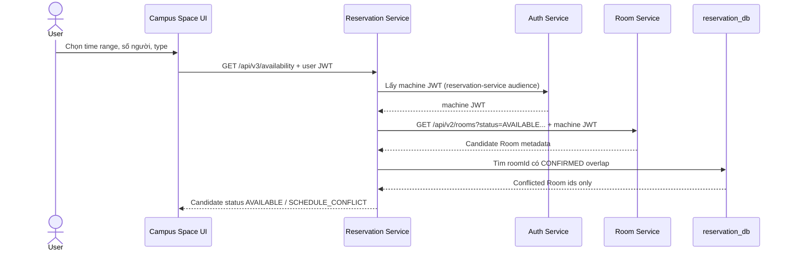

# Campus Operations Platform — capability upgrade sau TH6

## 1. Mục tiêu

Nâng Web UI từ client chứng minh REST endpoint thành ứng dụng vận hành có
workflow, role workspace và service capability rõ ràng. Đây là nâng cấp sau TH6;
không thay thế contract/evidence TH1–TH6 đã được chốt.

## 2. Những biên giới giữ nguyên

| Owner | Dữ liệu/capability | Không được làm |
|---|---|---|
| Auth Service | user, BCrypt password hash, JWT user/machine token | Browser không phát hành/kiểm tra token thay service |
| Room Service | Room catalog, state, capacity, Lab equipment | Reservation/UI không truy cập `room_db` |
| Reservation Service | Reservation, schedule conflict, availability read model | Room không ghi `reservation_db` |
| Audit Service | consume lifecycle event | Không quyết định create/cancel có thành công không |
| Web UI | session UX, role navigation, REST client | Không gọi DB/RabbitMQ hoặc chứa machine secret |

## 3. Availability là capability của Reservation Service

### API

```http
GET /api/v3/availability?from=2026-12-20T09:00&to=2026-12-20T10:00&attendeeCount=30&type=LAB
Authorization: Bearer <user JWT>
```

### Luồng



Reservation Service không trả requester, purpose hay Reservation của người khác.
Response Availability cũng không bảo đảm Reservation tạo sau đó thành công: khi
`POST /api/v1/reservations`, service kiểm tra Provider/schedule lần cuối để xử lý
race bằng `409 ROOM_SCHEDULE_CONFLICT`.

## 4. Reservation cancellation lifecycle

```text
CONFIRMED -- PATCH /api/v1/reservations/{id}/cancel --> CANCELLED
```

- Student chỉ hủy Reservation có `requesterId` trùng JWT claim của chính họ.
- Admin hủy theo authority ở backend.
- Room Manager không có quyền cancel endpoint.
- Record không bị delete: giữ history/audit.
- `CANCELLED` không tham gia kiểm tra overlap tiếp theo.
- Sau local transaction, Reservation Service publish `reservation.cancelled` tới
  `reservation.events`; Audit Service consume cùng audit queue với
  `reservation.confirmed`.

## 5. Two-surface UI

```text
/          Login Portal: Auth only
/app.html  Operations Application: dashboard + role workspaces
```

| Workspace | Student | Room Manager | Admin |
|---|---:|---:|---:|
| Dashboard | own reservation + candidate rooms | operational overview | operational overview |
| Booking wizard | yes | no | yes |
| Reservation listing | own data (server ownership) | query policy | query policy |
| Cancel own/administrative Reservation | own | no | yes |
| Room catalog | yes | yes | yes |
| Room Operations (create/update/delete/state) | no | yes | yes |

## 6. Hướng phase tiếp theo, không giả vờ đã làm

Khi Campus Operations đã ổn định, nền tảng có thể mở rộng bằng Notification
Service và utilization read model. Trước lúc đó, cần đưa Transactional Outbox vào
Reservation Service để bảo đảm event được retry sau local commit. Không thêm
microservice chỉ để tăng số lượng service; mỗi service mới phải có data owner,
event/API contract, consumer và user value riêng.
